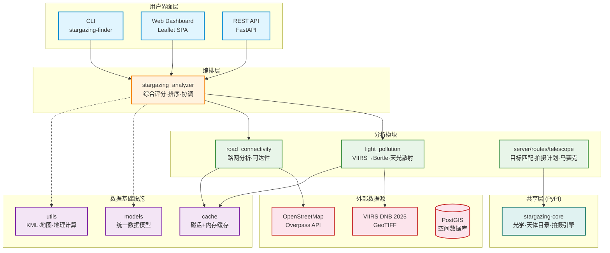
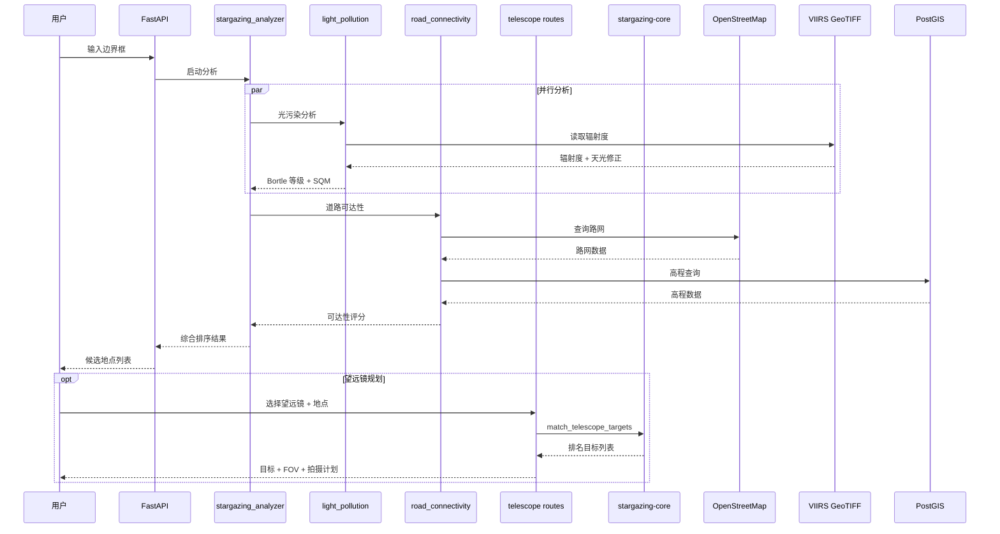

# Stargazing Place Finder

[English](README_EN.md) | 中文

## 项目简介

专为中国观星爱好者设计，基于光污染数据、地理信息、道路可达性和望远镜光学参数，智能推荐最适合观星的地点，并生成针对特定设备的深空天体拍摄计划。

## 功能特点

### 🌌 地点发现与分析
- **智能地点推荐**: 基于 VIIRS 光污染数据 + PostGIS 高程 + OSM 路网，多维度综合评分
- **光污染分析**: VIIRS DNB 辐射度 → 天光散射修正 → Bortle 等级 + SQM 值
- **道路连通性**: PostGIS `planet_osm_line` 路网图 + OSMnx 回退，计算可达性评分
- **海拔筛选**: 优先推荐高海拔、视野开阔的地点
- **避开网红点**: 智能过滤热门景点，寻找安静观星场所（规划中）

光污染数据有效性：分析器遵守 GeoTIFF 的 NoData 和 GDAL 掩膜，NaN/无穷值也视为缺失。
缺失像元的单点查询返回 `None`，批量项返回 `success=False`，地图瓦片透明；未标缺失的有限零值仍有效。
天光模型仅对有效样本归一化，无有效支持时保持未知，不用邻近天光补造缺失的原始辐射度。
这不代表模型经过实地校准。旧 Web/网格接口的默认显示值仍需结合来源标记解读；
地点评分公式未变，未知光污染仍走既有的 18 分回退，不能将其理解为已验证的观测条件。

### 🔭 望远镜与拍摄规划
- **设备预设**: 内置 Seestar S50、RedCat 51、Askar FRA300 等常见望远镜参数
- **目标匹配**: 根据焦距/口径/传感器/滤镜，推荐最适合拍摄的 Messier/NGC 深空天体
- **FOV 可视化**: 天区覆盖图、目标在焦平面上的填充比例、FOV 旋转
- **拍摄计划**: 单晚逐分钟观测序列，含中天翻转警告 + 月相分离 + 窄带推荐
- **马赛克拼接**: 大目标多面板拼接规划，可调重叠率（5–40%），导出面板坐标

### 🌙 星图与日月信息
- **交互式天图**: Aladin Lite 嵌入，实时显示目标 RA/Dec + FOV 框
- **高度曲线**: 目标整夜高度变化 + 适合度评分曲线
- **月相叠加**: 地图上实时显示日月位置，月相影响评估
- **地点 ↔ 目标联动**: 地图点击地点自动跳转可见目标，目标列表跳转天图

### 🗺️ 地图与可视化
- **光污染瓦片**: Leaflet 多层叠加（Bortle / SQM / 辐射度）
- **候选地点标记**: 聚类展示 + 详情弹出窗
- **海拔热力图**: 区域高程分布
- **面板联动**: 搜索结果 ↔ 天图 ↔ 目标列表统一管理

显式重建后的瓦片缓存也区分有效性变化：有效零值与 NoData/掩膜/NaN 之间可双向更新，
旧 handle 的晚到 PNG 不会覆盖新 handle 的有效性。这不增加文件自动监听或客户端缓存清理。

## 快速开始

### 安装依赖

```bash
uv sync
```

### 启动 Web 服务

```bash
uv run uvicorn server.main:app --host 0.0.0.0 --port 5001 --reload
```

启动后访问：

| 地址 | 说明 |
|------|------|
| `http://localhost:5001/` | Web UI（Leaflet SPA） |
| `http://localhost:5001/api/health` | 健康检查 |
| `http://localhost:5001/docs` | Swagger API 文档 |

### Docker 部署

配合 `mcp-stargazing` Docker 镜像使用，SPF Web 与 MCP Server 在同一容器中通过 supervisord 管理：

```bash
docker run -p 3001:3001 -p 5001:5001 mcp-stargazing
```

### 跨仓库 CI

SPF 的 PR 会自动用当前候选 wheel 运行 `mcp-stargazing` 测试，并与基线结果比较。
完整规则见
[mcp-stargazing/docs/dependency-chain-ci.md](https://github.com/StarGazer1995/mcp-stargazing/blob/main/docs/dependency-chain-ci.md)。

## API 端点

### 地点分析

| 端点 | 方法 | 说明 |
|------|------|------|
| `/api/health` | GET | 服务健康检查 |
| `/api/light_pollution` | GET | 视窗光污染数据（Bortle / SQM / 辐射度） |
| `/api/light_pollution/tiles/{z}/{x}/{y}.png` | GET | 光污染栅格瓦片 |
| `/api/coordinate_analysis` | GET | 单点坐标综合分析 |
| `/api/analyze_stargazing_area` | GET/POST | 区域观星地点搜索（分页 + 排序） |

### 望远镜

| 端点 | 方法 | 说明 |
|------|------|------|
| `/api/telescope/presets` | GET | 望远镜设备预设列表 |
| `/api/telescope/resolve?name=M42` | GET | 优先从本地星表解析天体坐标（ICRS，度），其它名称有界查询远程解析服务 |
| `/api/telescope/optics` | POST | 计算光学参数（FOV、放大倍率、极限星等） |
| `/api/telescope/targets` | POST | 匹配深空天体目标（排名 + FOV 适配 + 月相） |
| `/api/telescope/plan` | POST | 生成单晚拍摄计划（时间序列 + 中天翻转 + 窄带推荐） |
| `/api/telescope/mosaic` | POST | 马赛克拼接规划（多面板 + 可调重叠率） |

顶部搜索框随模式切换：地图/区域分析搜索地点，望远镜模式搜索天体。
M、NGC、IC 编号忽略空格和大小写，命中 `stargazing-core` 随包星表时不访问外部解析服务；
返回 `name`、`ra`、`dec`、`source`（本地为 `local_catalog`）。天体定位不等待星图影像下载。
其它名称的远程解析总等待上限为 5 秒：确认未找到返回 HTTP 404 / `OBJECT_NOT_FOUND`，
网络、超时或无效回复返回 HTTP 503 / `RESOLVER_UNAVAILABLE`，不把网络失败当成天体不存在。
页面显示搜索中、已定位或明确失败提示；影像能否显示仍取决于 HiPS 图源网络。

## 技术架构

### 架构总览



### 数据流



## 核心数据模型

### 统一 Location 模型

```python
class Location(BaseModel):
    name: str                    # 地点名称
    lat: float                   # 纬度
    lon: float                   # 经度
    elevation_m: float | None    # 海拔（米）
    bortle_class: int | None     # Bortle 等级（1–9）
    road_distance_km: float | None  # 道路距离
    score: float | None          # 综合评分（0–100）
    location_type: str           # 地点类型标签
```

### 望远镜模型（来自 stargazing-core）

```python
class TelescopeConfig(BaseModel):
    focal_length_mm: float
    aperture_mm: float | None
    sensor_width_mm: float | None
    sensor_height_mm: float | None
    sensor_pixel_size_um: float | None
    central_obstruction_pct: float
    reducer_factor: float
    barlow_factor: float
    mount_type: str               # "equatorial" | "altaz"
    filter_type: str | None       # "Hα" | "OIII" | "SII" | None

class ShootingPlan(BaseModel):
    slots: list[ShootingSlot]     # 时间排序的拍摄时段
    moon_warnings: list[str]      # 月相影响警告
    total_exposure_min: float     # 总曝光时间
```

## 技术栈

| 层 | 技术 |
|----|------|
| **Web 框架** | FastAPI + Uvicorn |
| **前端** | Leaflet.js + Aladin Lite + 原生 JS（3142 行 `app.js`） |
| **光污染** | rasterio 解析 VIIRS DNB GeoTIFF + 天光散射模型 |
| **路网** | OSMnx + NetworkX + PostGIS `planet_osm_line` |
| **数据库** | PostGIS（高程 + 空间查询） |
| **共享库** | stargazing-core ≥ 0.1.0（PyPI） |
| **包管理** | uv |

## 依赖关系

```
stargazing-place-finder
└── stargazing-core>=0.1.0  ← PyPI registry
    ├── TelescopeConfig, TelescopeOptics, TELESCOPE_PRESETS
    ├── match_telescope_targets, score_deep_sky_objects
    ├── generate_shooting_schedule, ShootingPlan
    ├── compute_mosaic_grid (MosaicGrid, MosaicPanel)
    └── CelestialPosition, MoonInfo, RiseSet, GeoPoint, ...
```

本地开发时如需使用未发布的 core 版本：

```toml
# pyproject.toml（不要提交此配置）
[tool.uv.sources]
stargazing-core = { path = "../stargazing-core" }
```

## 评分算法

综合评分（0–100 分）由四个维度加权计算：

| 维度 | 权重 | 说明 |
|------|------|------|
| 光污染 | 0–35 | Bortle 等级越低分越高 |
| 城镇隔离 | 0–20 | 远离光污染源加分 |
| 道路可达 | 0–20 | 路网连通性 + 距离 |
| 海拔突出 | 0–15 | 相对周边高程差 |
| 地点类型 | 0–10 | 山峰 > 天文台 > 观景台 |

## 数据库配置

PostGIS 用于高程数据和空间查询，支持 JSON / TOML 两种配置格式。

```bash
export STARGAZING_DB_CONFIG="/path/to/config/db_config.json"
```

**JSON 格式**：
```json
{
    "host": "192.168.1.8",
    "port": 5455,
    "database": "osm_db",
    "user": "postgres",
    "password": "postgres123"
}
```

无 PostGIS 时，系统自动回退到 Overpass API + Open-Elevation API。

## 缓存架构

由 `src/cache/` 统一管理，所有缓存存储在项目根目录 `cache/` 下：

```
cache/
├── images/           # 地图图像缓存
├── road_networks/    # 道路网络数据
├── osmnx/           # OSMnx 地图缓存
├── light_pollution/  # 光污染数据缓存
└── temp/            # 临时文件
```

特点：MD5 缓存键、磁盘持久化、自动恢复、按类型清理。

地图 PNG 瓦片另有进程内缓存（默认 3600 秒、最多 500 条 LRU）。缓存按实际打开的
GeoTIFF 分析器代次与瓦片坐标隔离；公开 `init_light_pollution_analyzer(...)` 显式重建
文件句柄及 skyglow 模型后，服务端重新请求会使用新代次。旧请求晚完成不能覆盖新代次
的瓦片；未初始化、已关闭或身份未知的句柄不能复用之前来源的瓦片。

该代次不是数据集版本或资料年龄。只替换同路径文件不会自动重载，MCP 地点结果、
其他分析器及浏览器/CDN 缓存也不会随之主动失效；HTTP `max-age=3600` 保持原值，
客户端可能继续复用已有响应。并发关闭/读取的完整资源租约与来源更新时间规则仍待验证。

GIS 地点查询按后端区分缓存：PostGIS 结果只在当前 `GisQueryService` 实例内存中
复用（默认 24 小时，读取不续期），服务/连接配置重建后重新查询；不跨数据库、用户
或实例复用磁盘结果。Overpass 仍使用内存与磁盘缓存，带独立后端标识；旧的未标记
来源条目不再读取。数据库实例内清缓存不会删除共享磁盘缓存。

这会减少数据库服务重建后的缓存复用，尚未做部署性能对照。缓存寿命不是资料年龄；
本规则不监听数据库内容、配置文件或 GeoTIFF 更新，也不保证上层结果缓存主动失效。
配置/源版本变化仍需调用方重建实际服务和文件 handle，来源更新时间未知时保持未知。

## 项目状态

✅ **已完成的重大更新**：

| 版本 | 内容 |
|------|------|
| 0.8.0 | stargazing-core 迁移至 PyPI；FastAPI 迁移完成 |
| Phase 4 | 拍摄计划 + 马赛克拼接 + 高度曲线优化 |
| Phase 3 | 地点↔目标联动 + 月相叠加 + 面板统一 |
| Phase 1 | 望远镜天图 + FOV 旋转 + 地图 UI 刷新 |
| 0.7.0 | FastAPI 迁移（Flask → FastAPI）、测试整合 |

🔄 **计划中**：
- 天气数据集成（实时预报 + 观测窗口评分）
- 科学评分系统（用户自定义权重）
- 国际暗夜保护区数据
- 移动端适配

## 贡献指南

欢迎参与贡献！请确保代码符合项目规范，提交前通过测试。

## 许可证

MIT License

---

*让我们一起探索星空，寻找最美的观星地点！* ✨

### 设备与拍摄目标排序

设备列表由 `/api/telescope/presets` 提供，网页动态读取共享 core 预设；
HOPE D60 + ASI2600MC Air 的既有配置为 280 mm、60 mm 口径、
23.5 × 15.7 mm 传感器、3.76 µm 像元。选择预设后完整参数用于目标匹配、计划和拼接。
接口加载失败时仍可使用自定义参数；手工修改光学参数会切回自定义，清除旧预设的附加参数。

core 0.2.3 起，拍摄目标需在太阳低于 −18°、高度至少 25°时有连续 30 分钟的采样可用时段，
不再要求黎明仍可见。基础权重仍为画幅 40%、表面亮度 30%、滤镜 20%、可拍时段平均高度 10%；
另按最长连续时段（两小时封顶）调整，按各目标可拍样本计算月光扣分，超画幅按覆盖规模降分。
纯疏散星团的构图尺寸使用带来源与许可的 OpenNGC 补充表，星云范围保持原目录值。
这是启发式取景和时段排序，不是天气、信噪比或成片成功率预测。


### SPF 目标排序与 SHO 建议（0.9.6）

网页默认按**查询时刻起的剩余几何可拍总时长**排序，同等总时长先比较最长连续时段，
再比较画幅适配；可切换“现在先拍”（当前可拍目标中，当前窗口即将结束者优先；
尚不可拍的目标按下个窗口开始时间排列）、“构图适配”和“辅助综合分”。
所有模式先计算完整候选池，再排序、截取返回数量，不对旧综合分的前若干名局部重排。
时间类模式剔除已知最长剩余窗口不足30分钟者；资料不足者保留未知并排后。
排序不改变独立拍摄计划调度器的执行顺序；当前不提供用户项目优先级、项目完成度或切换开销优化。

卡片分别展示剩余总时长、最长连续时段与当前/下个窗口。时间使用15分钟采样，
两端均满足目标高度≥25°、太阳高度≤−18°，且月亮在地平线上方、照明比例>0.1时月距≥15°；
不跨越缺失采样，不把已过去的时间计入。阈值沿用当前core默认值，尚不是页面可配置项；
这些是几何条件，不是天气、地形遮挡或实际可积分曝光的保证。

SHO 建议独立于排序，按目录类型提供“可考虑，先核实SII”“不建议作为主体方案”或
“资料不足/需逐目标核实”。发射星云不能仅凭类型确认SII、OIII足够强；
SNR和行星状星云需逐目标核实，星系、反射星云和球状星团主体通常优先宽带。
疏散星团目录可能混入伴生星云范围，因此标记待核实，不据此排除SHO。
当前没有逐目标发射线通量目录，返回 `sii_strength: null` 和 `basis: catalog_type_only`。

相机类型可手动选未知、彩色、单色。既有HOPE `hope_d60_asi2600mc_air` 预设识别为彩色；
其它未经确认的预设保持未知。彩色相机也可以采集SHO：需额外SII或能分离三通道的配对双窄带方案，
单个常见Hα/OIII双窄带不能提供独立SII；单色相机可分别采集三个窄带通道。
建议不判断用户是否已经持有滤镜，不估计通道信噪比或曝光量。

REST `/api/telescope/targets` 新增顶层参数：

- `sort_by`: `imaging_time` / `setting_soon` / `fov` / `heuristic`。为兼容旧调用，省略时仍用 `heuristic`；网页显式传 `imaging_time`。
- `camera_type`: `unknown` / `color` / `mono`，省略为 `unknown`。
- `limit`: 1–100，省略为20。非法显示参数返回HTTP 422。

响应增加 `sort_by`、`camera_type`、`total_available`；各目标增加 `visibility`
（`total_minutes`、`longest_minutes`、`available_now`、Unix秒窗口数组）及 `sho_advice`。
缺少时间/几何/月相依据时，时长和可用状态为null，不默认成晴天或零分钟。
`/api/telescope/presets`增加展示元数据`camera_type`，不改变core光学模型；
`/api/telescope/plan`也附带SHO建议，但保留原调度算法。更改设备、光学参数、排序或相机类型后，
隐藏旧结果和旧计划入口，需重新匹配，避免把旧建议当成新配置的结果。

依据：
[ZWO ASI2600MC/MM Air](https://www.zwoastro.com/product/zwo-asi2600mc-air/)、
[Astronomik窄带滤镜](https://www.astronomik.com/en/Narrowband-Filters/)、
[Optolong彩色相机配对双窄带](https://www.optolong.com/cms/document/detail/id/485.html)。
